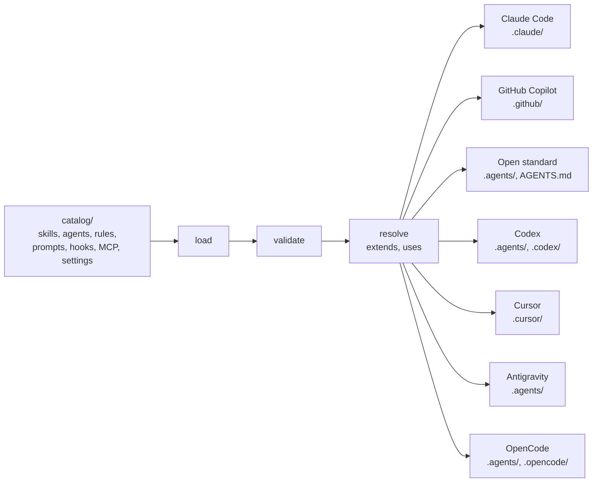

<p align="center">
  
</p>

<p align="center">
  <strong>Write AI coding instructions once. Install them into Claude Code, GitHub Copilot and five more targets.</strong>
</p>

<p align="center">
  <a href="https://github.com/makubexD/sigil/actions/workflows/ci.yml"></a>
  <a href="https://github.com/makubexD/sigil/tags"></a>
  <a href="LICENSE"></a>
  <a href="docs/guides/operations.md#build-and-link"></a>
</p>

<p align="center">
  <a href="#install">Install</a> · <a href="#quick-start">Quick start</a> · <a href="docs/index.md">Docs</a>
</p>

## Why

Every AI tool has its own format for coding instructions. You write "how to write a good unit test" for Claude, again for
Copilot, and when the guidance changes the copies drift. Sigil keeps one provider-neutral catalog and turns it into each
tool's native files.



## What you get

- **One neutral catalog.** Artifacts are plain Markdown with YAML frontmatter. Tool names, model hints and hook events stay
  neutral, and each target translates them.
- **Updates that respect your edits.** `.sigil/manifest.json` records a hash of every file. `sigil status` shows what you
  changed, and `sigil update` leaves an edited file alone unless you pass `--force`.
- **Config merged, never overwritten.** Hooks, MCP servers and settings merge into your existing files, and a file in your
  home folder is backed up before the first write.
- **A trust scanner.** `sigil check --trust` looks for secrets and prompt-injection patterns in an artifact, and CI runs the
  scan over the whole catalog.
- **Plugin marketplaces.** Each release publishes the packs as a Claude Code marketplace, which Copilot can read too.

## Install

Sigil **isn't on npm yet**, so you build it from a clone. You need Node.js 20.19 or newer, npm and git.

```bash
git clone https://github.com/makubexD/sigil.git
cd sigil
npm install
npm run build
npm link            # puts a global `sigil` command on your PATH
```

Alternatives to `npm link` are in [Build and link](docs/guides/operations.md#build-and-link).

**Claude Code without a clone:** install a pack as a plugin. Add the marketplace inside Claude Code, then install from your
project's shell:

```
/plugin marketplace add makubexD/sigil#marketplace
claude plugin install spec-driven@sigil --scope project
```

Each pack is one plugin, and each hook and MCP server is its own opt-in plugin (`hook-<name>`, `mcp-<name>`). Rules ride
inside the skills that use them, and loose rules and settings still need `sigil add`. Pinning a release, updates and removal
are in the [Claude Code setup](docs/setup/claude-code.md).

## Quick start

Run this from the root of the project you want to equip, not from the sigil clone:

```bash
sigil
```

The guided menu checks the folder, shows what's set up, installed, missing or edited, and offers the next step. Every choice
runs a command you could type yourself, and the guided flows print it. Details are in
[Using the guided menu](docs/guides/consuming.md#using-the-guided-menu).

The same things as commands:

```bash
sigil list --kind skill                        # browse (also: sigil search <query>)
sigil add skill:typescript/ts-generate-tests   # one artifact plus what it depends on
sigil add pack:typescript-starter              # or a curated bundle
sigil status                                   # what is installed, and is it healthy?
```

`sigil --help` lists every command, and `sigil <command> --help` shows its options and defaults. The
[consuming guide](docs/guides/consuming.md) covers the rest, and every flag is in the
[CLI reference](docs/reference/cli-flags.md).

## The catalog

| Kind                     | Count    | What it holds                                                                   |
| ------------------------ | -------- | ------------------------------------------------------------------------------- |
| Skills                   | about 45 | Task workflows: generate tests, scaffold a project, audit dependencies, release |
| Agents                   | about 40 | Focused reviewers and specialists with restricted tools                         |
| Rules                    | about 65 | Coding standards per stack, loaded where they apply                             |
| Prompts                  | a few    | Commands you run by hand, such as `explain-diff`                                |
| Hooks, MCP, and settings | a dozen  | Config that merges into your files, such as `protect-config`                    |

The stacks are C#, TypeScript, Angular, Python and React, plus shared artifacts for any language.

| Pack              | What it installs                                                                     |
| ----------------- | ------------------------------------------------------------------------------------ |
| `essentials`      | For any language: `explain-diff`, plus the filesystem MCP and config-file protection |
| `<stack>-starter` | A small setup for one stack, built around test generation                            |
| `<stack>-tooling` | The full suite for one stack: its skills, agents and rules                           |
| `spec-driven`     | The `/feature` conductor: spec, plan, TDD build and review, with approval gates      |
| `cli-builder`     | Design, build or audit a command-line interface and its setup wizard                 |
| `deepseek-worker` | Plan in your main session and hand mechanical steps to the paid DeepSeek API         |

`<stack>` is `dotnet`, `typescript`, `angular`, `python` or `react`. Every artifact, its packs, the tools it installs into and
its `sigil add` command are in the [artifact index](docs/reference/artifacts.md). Pack definitions are in
[`packs.yaml`](packs.yaml).

## Targets

Pick one with `sigil add --target <name>`. Without it, Sigil uses the tool set up in the folder. If there's none, a terminal asks
and a script gets `claude`.

| Target                                                   | `--target`        | What `sigil add` delivers                                              |
| -------------------------------------------------------- | ----------------- | ---------------------------------------------------------------------- |
| [Claude Code](docs/setup/claude-code.md)                 | `claude`          | Skills, agents, rules, prompts, hooks, MCP, settings                   |
| [GitHub Copilot](docs/setup/copilot.md)                  | `copilot`         | Skills, agents, instructions, prompts, hooks, MCP                      |
| [Open standard](https://agentskills.io/specification)    | `agents-standard` | Skills, with each skill's rules inlined                                |
| [OpenAI Codex](docs/setup/codex.md)                      | `codex`           | Skills with rules inlined, hooks, MCP                                  |
| [Cursor](docs/setup/cursor.md)                           | `cursor`          | Skills, agents, rules as `.mdc`, hooks, MCP                            |
| [Antigravity](docs/setup/antigravity.md)                 | `antigravity`     | Skills, agents, repo-wide rules, hooks, MCP                            |
| [OpenCode](docs/setup/opencode.md)                       | `opencode`        | Skills with rules inlined, agents, commands, MCP                       |
| [Any agent, with `npx skills`](docs/setup/skills-cli.md) | not `sigil`       | Single skills, from the `skills` branch; `sigil status` can't see them |

Real limits, in brief. The setup guides have the rest, and [capabilities](docs/reference/capabilities.md) has every kind per
target with the reason for each gap.

- **Copilot:** commit the files, since its cloud agent reads the repository. The marketplace delivers skills, agents and
  prompts, but its `hook-*` and `mcp-filesystem` plugins fail there, so install those with `sigil add`.
- **Open standard:** any tool that reads `.agents/skills/` can use it, and a full `sigil build` also writes a root `AGENTS.md`.
  Copilot and Cursor read that folder too, so don't install the same skills for them and for this target.
- **Shared skill files:** Codex, the open standard and Antigravity write the same `.agents/skills/` files, so install skills for
  one of them. `sigil add` refuses the second.
- **Codex:** run it in a trusted project and review hooks with `/hooks`, because it skips an unreviewed hook with no error.
- **Antigravity:** scoped rules are skipped because no glob rule attached in testing. They still arrive inside the skills.
- **OpenCode:** `explain-diff` is skipped, and there are no hooks. A catalog agent can run `cat .env`, and nothing stands behind it.

## Who are you?

| You want to...                                                  | Start here                                                                                   |
| --------------------------------------------------------------- | -------------------------------------------------------------------------------------------- |
| Just use Sigil in my project (including the interactive wizard) | [docs/guides/consuming.md](docs/guides/consuming.md)                                         |
| Use Sigil as a Claude Code plugin                               | [Plugin section of consuming.md](docs/guides/consuming.md#install-a-pack-as-a-claude-plugin) |
| Use it with GitHub Copilot                                      | [docs/setup/copilot.md](docs/setup/copilot.md)                                               |
| Publish my own catalog or marketplace                           | [docs/guides/publishing.md](docs/guides/publishing.md)                                       |
| Suggest or write a new skill, rule, or agent                    | [CONTRIBUTING.md](CONTRIBUTING.md) and [docs/guides/authoring.md](docs/guides/authoring.md)  |
| Contribute code to Sigil itself                                 | [CONTRIBUTING.md § Contributing code](CONTRIBUTING.md#b-contributing-code)                   |
| See what works today and what is planned                        | [Support matrix](docs/index.md#support-matrix)                                               |

<details>
<summary><strong>Library usage</strong></summary>

Sigil is primarily a CLI, but `config-merge`'s pure JSON-merge primitives, the machinery behind `mcp`, `hook` and `settings`
installs, drift detection and repair, are also a small library. A tool can use them to detect or repair drift in a
sigil-managed config file without shelling out to the CLI:

```ts
import { applyMerge, classifyConfigDrift, detectConfigDrift } from 'sigil';
```

Everything else (pipeline stages, target adapters, wizard, commands) is intentionally not exported. Only `.` and
`./package.json` resolve through the package name. See `src/index.ts` for the exported surface and the "public library surface"
rule in `.claude/rules/repo-cli.md` for why it stays curated.

</details>

## Learn more

Start at [docs/index.md](docs/index.md): a map by audience, a glossary and the support matrix. See also
[CHANGELOG.md](CHANGELOG.md) for version history and [CLAUDE.md](CLAUDE.md) for the rules code contributors must keep.

## License

MIT — Copyright (c) 2026 makudev1719
